# HU Launcher: fast launcher and debloater for cheap Android car head units

A light home screen, bloatware remover and privacy firewall for cheap, unbranded Android car
head units: the no-name "Android car stereo", "Android car radio" or double-DIN (2-DIN)
multimedia players sold online. They usually have a MediaTek (MTK) or Rockchip chip and a
9 or 10 inch screen. No root needed.

| Home | All apps (5 × 2 pages) |
|---|---|
| 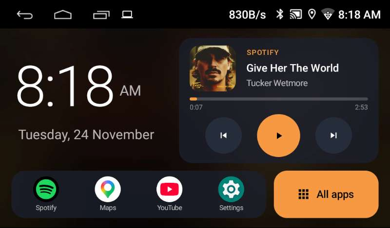 | 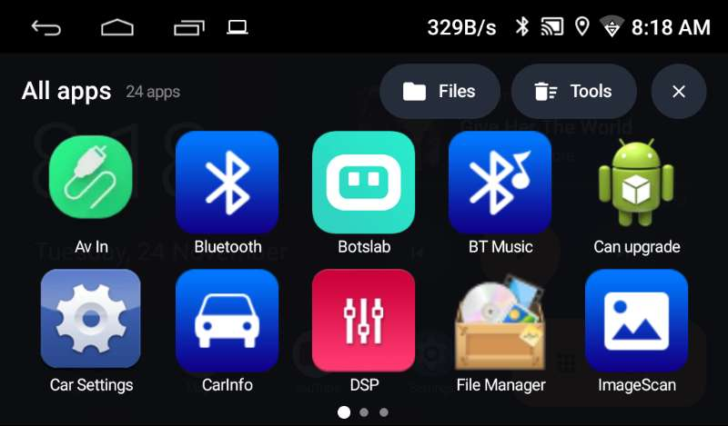 |
| **Night screen** | **Night screen settings** |
| 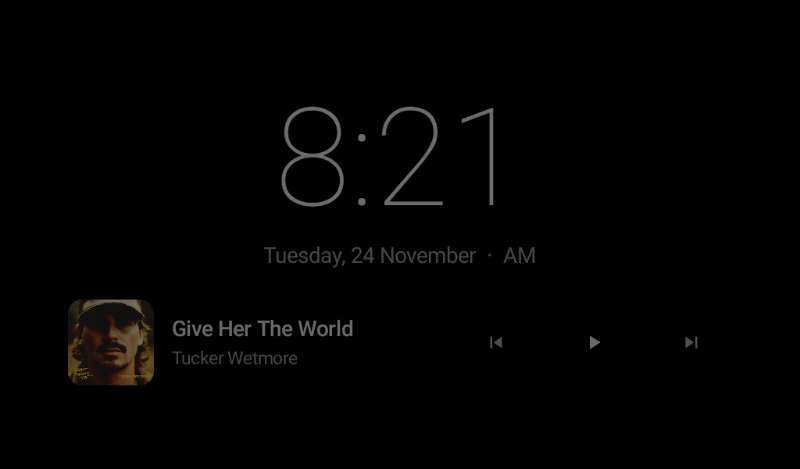 | 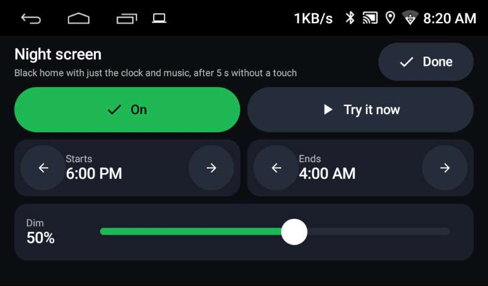 |
| **Debloat** | **Network firewall** |
| 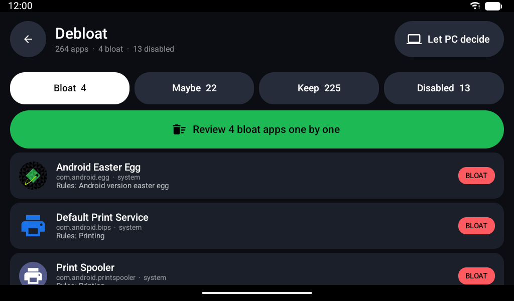 | 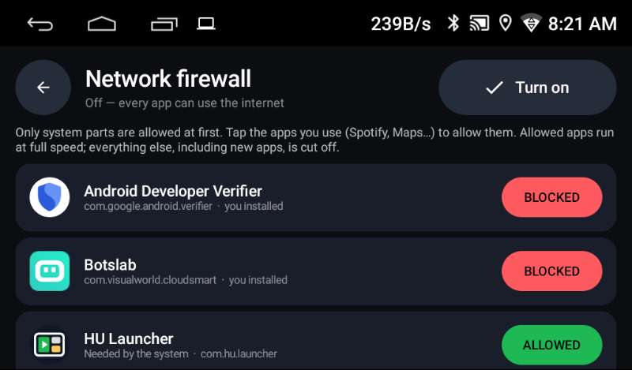 |
| **Activity** | **Setup** |
| 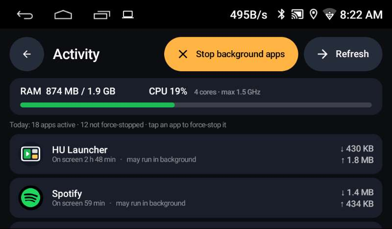 | 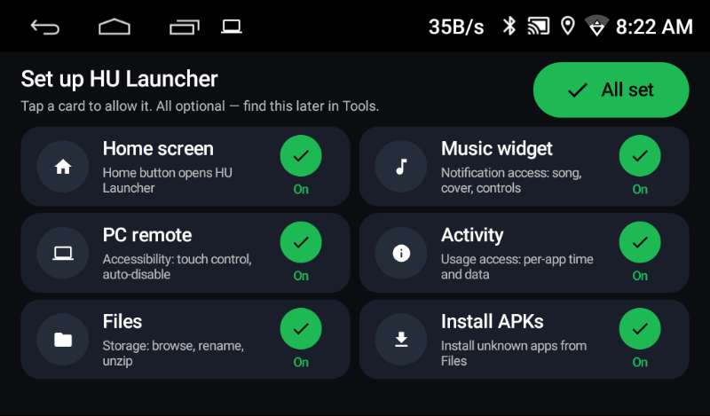 |
| **Tools** | **Files** |
| 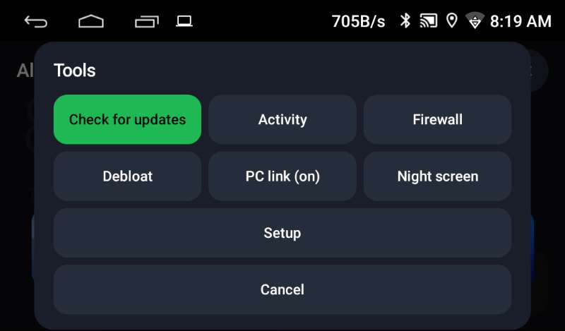 | 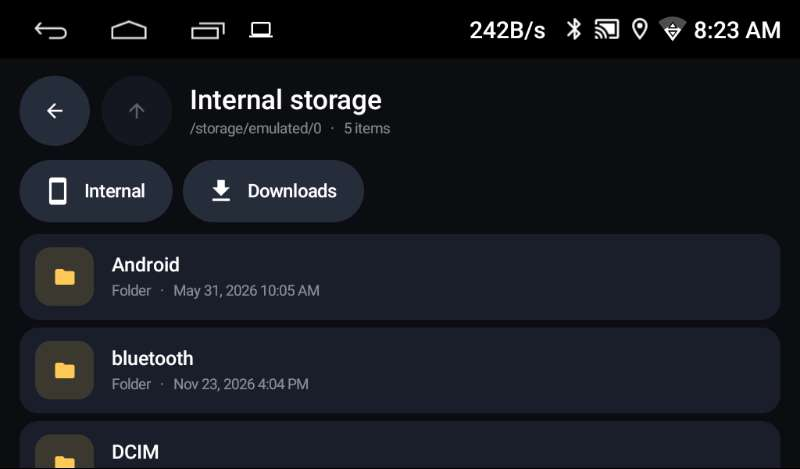 |
| **Check for updates** | |
| 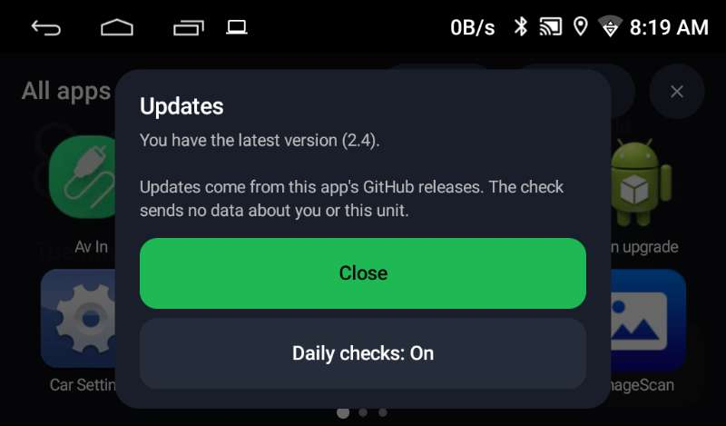 | |

<sub>Screenshots from a real MT8163 head unit (1024×600). The PC link address and PIN are blanked out.</sub>

## Why this exists
Cheap no-name Android head units usually have weak hardware: an old MediaTek or Rockchip chip,
1–2 GB of RAM and a 1024×600 screen. They also come with a lot of preinstalled software you never
asked for, such as OTA clients, log uploaders, location services that report to third parties,
and vendor "speed-up" tools that kill your music app. On top of that comes a heavy stock launcher.
Many of these units also report a newer Android version than they really run. HU Launcher was made
to deal with them:
- **Keep resource use down:** a home screen that uses about 0% CPU when idle and around 20 MB
  of RAM, plus tools to disable bloat or keep it stopped.
- **Protect your privacy:** find and switch off the apps that phone home. A per-app firewall
  cuts the rest off the internet, with no root and no cloud service.

All of it runs on the unit, or on your own PC on your own Wi-Fi. The only internet request the app
makes is a once-a-day update check that reads this repo's latest release from GitHub. It sends no
data about you or the unit, and you can turn it off in Tools → Check for updates.

**Common reasons people end up here:**
- The head unit is slow or laggy.
- The stock launcher is ugly.
- They want to remove bloatware from an Android car stereo without root.
- An app keeps killing Spotify or Google Maps in the background (MediaTek DuraSpeed and similar).
- They want to stop a Chinese head unit sending data home: Adups FOTA, log uploaders, Baidu location.
- They want a lightweight launcher with big buttons for driving.

It works on Android 7 to 9 head units, and is also fine on newer ones. It has been tested on an
MT8163 unit (2 GB RAM, 1024×600) that claims Android 13 but runs Android 9.
The home screen adjusts to the screen: it has been checked at 800×480, 1024×600, 1280×720, 1920×720
and portrait 768×1024.

## Features
- **Home:** large clock and date, a large now-playing card (album art, blurred art backdrop,
  96–112 dp play/skip buttons), and a dock of up to 5 pinned apps. Tap the card to open
  Spotify's Now Playing. Swipe up anywhere to open All apps.
- **All apps:** horizontal pages of 5 × 2 very large icons. Swipe left and right to change page,
  and swipe down to close. Long-press an app to pin it, open App info, or uninstall it.
- **Debloat:** scans every package and sorts it into Bloat, Maybe, Keep or Disabled. It then
  goes through them one by one: it opens App info, you tap Disable, and the list moves on by itself.
- **Files:** a built-in file manager (All apps → Files) for browsing internal storage, USB and SD. You can rename files and folders (extension included), delete them (with a confirmation step; system folders such as `Android` are protected), install APKs, read text files and extract zips. It runs in its own process, so it never slows down the home screen.
- **Let PC decide (made for Claude Code):** every head-unit vendor ships different packages, so
  no built-in list can know them all. This mode lets [Claude Code](https://claude.com/claude-code)
  on your PC connect to the unit over your Wi-Fi (PIN-protected, `_hulauncher._tcp`, port 8765).
  It reads the full app list with permissions, services and file paths, works out what each app
  does, and sends back a verdict for each one: bloat, maybe or keep, with a reason.
- **Setup screen:** on first start, one screen lists every permission (home app, notification access, accessibility, usage access, storage, install APKs). Each card opens that exact setting, where Android allows it, and shows a tick when it's on. You can open it again from Tools → Setup.
- **Remote control:** turn on Tools → PC link, then open `http://<unit-ip>:8765` in a PC browser. You see the screen live and can click, swipe, scroll, type and press Back/Home. Screen sharing asks once each time it starts (tick "Don't show again"). Touch needs the "HU Launcher remote" accessibility service, which you turn on once.
- **Helper (same accessibility service):** Debloat → Review → **Auto-disable all** presses Disable and confirms for each app. Activity can **force-stop** an app or **stop background apps** (only apps you installed, never the one playing music). Screen-share prompts are accepted automatically.
- **Network firewall:** a VPN-based allow-list (Tools → Firewall). At first only the system parts that other things quietly depend on are allowed: network and hotspot sign-in checks, clock sync, mobile data, the download manager, Google Play services and Play Store, offline voices and GPS assistance. Everything else, including Spotify, Maps and any app you install later, is cut off until you tap it to allow it. Allowed apps bypass the firewall entirely, so they run at full speed. Blocking a system part asks first. It comes back on by itself after a reboot.
- **Updates:** once a day the app checks this repo's GitHub releases. A new version shows a quiet
  notification in the notification shade only, with no sound and no pop-up over your map.
  - **Update** downloads the APK and opens the installer. The helper presses Update for you on Android 9 to 13.
  - Tools → **Check for updates** asks GitHub right away and offers **Update now**. It also has the on/off switch for the daily check.
- **Keep Spotify ready (optional, Tools → Spotify ready):** HU Launcher stays connected to Spotify's
  media service, so Android keeps Spotify loaded and restarts it if it gets closed. Music starts
  instantly and isn't lost when memory runs low. No extra CPU; Spotify keeps its usual memory.
- **Night screen (optional):** many cheap head units are still too bright at minimum backlight.
  Turn on Tools → Night screen and, between two times you choose (6 PM to 4 AM by default), the home
  screen turns almost black after 5 s without a touch. Only a dim clock and a small music widget
  (song, art, play/skip) stay, and the status bar hides. A slider sets how dim they are (0–90%).
  Tap anywhere to get the normal home screen back. It only replaces the home screen, not other apps.
- **Activity:** live RAM, CPU clocks and temperature, plus each app's screen time and data used today (needs Usage access). Android 8 and newer don't let apps see other apps' CPU or RAM.

Plain Java and framework Views only: no AndroidX, Compose or native code. The APK is about 130 KB.

## Download
Get `HULauncher.apk` from [Releases](../../releases), or build it yourself (below). Release APKs
are signed with the author's key. If you build your own, uninstall the release first: Android
won't update an app signed with a different key.

Only APIs up to 28 (Android 9) are used, and the app never trusts the reported Android version,
because many units claim a newer one than they really run.

## Build
```powershell
.\build.ps1
```
Gives `HULauncher.apk` (JDK 21 and an Android SDK are needed; no Gradle).
The first build creates your own throwaway signing key, `signing.keystore`, which is git-ignored.
Android only installs an update if it's signed with the same key, so keep that file if you plan to update later.

## Install on the unit
1. Send `HULauncher.apk` to the unit (Bluetooth or USB stick) and install it.
2. Open **HU Launcher**. When asked, tap **Choose home app**, pick HU Launcher, then **Always**.
3. Tap the music card and allow **Notification access** for HU Launcher. This shows the song
   and the art. Play, pause and skip work without it.
4. When asked, choose **Scan now** (later: All apps → Debloat).

## Let the PC decide (with Claude Code)
This mode is how Claude Code analyses your unit's apps. Each brand of cheap head unit ships its
own mix of vendor packages, and Claude Code can look at what each one asks for and does, then
decide.
1. On the unit: All apps → Debloat → **Let PC decide** (or Tools → PC link). Note the PIN.
2. On a PC on the same Wi-Fi, open Claude Code in this repo and ask it something like:
   > Connect to my head unit with PIN 123456 and decide which apps are bloat.

   Claude Code then does the following with `pc\hu.ps1`:
   - Runs `pull`, which finds the unit and saves `pc\apps.json`. That file holds every package
     with its permissions, services, receivers and install path.
   - Writes `pc\verdicts.json` (`{"pkg": {"v": "bloat|maybe|keep", "why": "..."}}`).
   - Runs `push` to send the verdicts to the unit.

   With the helper on, it can also disable the apps for you (`disable`), put locked ones on the
   keep-stopped list (`keep add`), and check the result with screenshots.
3. On the unit, open the Bloat tab and tap **Review … one by one**, or **Auto-disable all**.

You can also do it by hand: run the same `hu.ps1 pull` / `push` commands and write the
verdicts yourself. `pc\verdicts.example.json` is a real example from one MediaTek unit.

Order of priority: your own choices (long-press a row) beat PC verdicts, and PC verdicts beat the
built-in rules. The built-in rules are cautious. Anything that looks like car hardware (CAN bus,
MCU, radio, Bluetooth, cameras, steering keys, vendor core) and every other home app is kept.

## Limits
- Without root, the only way to remove an app is the system App info page (Disable or Uninstall).
  Some vendor and system apps show a greyed-out Disable button. Those go on the **keep stopped**
  list instead (automatically when Disable is greyed out, or Activity → app → Keep it stopped):
  - **When it checks:** at most once a minute, when the home screen comes up. A check costs well under 1 ms.
  - **If an app has started by itself:** it's killed silently in the background.
  - **Full Force stop:** happens with the helper on, after 10 s of no touches on the home screen. It also blocks the app's boot and alarm auto-starts, until something launches it again. App info shows for about 2 s.
  - **Apps that keep coming back:** each return after a force stop doubles the wait before the next one (10 min → 24 h). So it can never get stuck in a stop/restart loop, and it never interrupts another app you're using.
- Installing over the PC link needs a tap on **Install/Update** on Android 14 and newer, which hide
  the installer's buttons from accessibility services. On Android 9 to 13 the helper presses them for you.
- Most head units let apps change files only on internal storage. USB sticks and SD cards can be browsed and opened, but renaming or extracting on them fails with a clear message.
- Some Chinese units set their own launcher back as home after a reboot. If that happens, disable
  the stock launcher only once HU Launcher works well as home.

## PC script commands
```powershell
.\pc\hu.ps1 remote -Pin 123456            # start screen sharing, then open the printed address
.\pc\hu.ps1 shot -Pin 123456              # save a screenshot to pc\screen.jpg
.\pc\hu.ps1 tap 0.5 0.5 -Pin 123456       # x y as fractions of the screen
.\pc\hu.ps1 key back -Pin 123456          # back | home | recents | notifications
.\pc\hu.ps1 net -Pin 123456               # firewall state per app
.\pc\hu.ps1 block com.adups.fota -Pin 123456
.\pc\hu.ps1 stats -Pin 123456             # RAM / CPU / temperature + today's per-app usage
.\pc\hu.ps1 install HULauncher.apk -Pin 123456   # upload an APK over Wi-Fi and install it
.\pc\hu.ps1 install bt -Pin 123456        # install the newest APK the unit received over Bluetooth
# Extra HTTP endpoints (X-Pin header): GET /apk?pkg=<preinstalled app> downloads that system
# app's APK so the PC can inspect what a vendor app does; GET/POST /spotify shows or sets Keep Spotify ready.
.\pc\hu.ps1 keep -Pin 123456              # keep-stopped list   (keep add|remove <pkg...>)
```
Updating HU Launcher itself works the same way. The PC link comes back on its own with the same
PIN, so the script waits and prints the new version. The PIN only changes when you stop the link
or the unit reboots, and the link stays off after a reboot.
